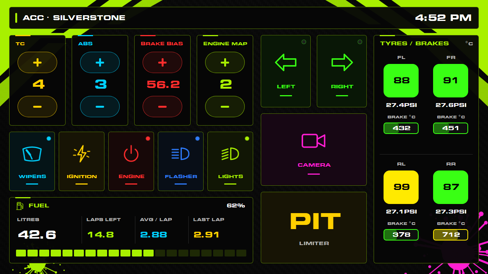

# SimHub Neon Button Box

A touchscreen button box for SimHub, with a carbon background, neon controls, and live fuel, tyre, and brake telemetry. Use it on a tablet, phone, or second PC display alongside your racing simulator.

**Sister project:** [SimHub Turns Dash](https://github.com/StormFuel/simhub-turns-dash) is the companion telemetry dashboard with the **same look and feel**. The projects share a livery palette and visual style. This button box works independently: you do not need the sister dashboard or its Turn Telemetry plugin.



The layout is 1280 × 720 (16:9 landscape). In SimHub it appears as **Button Box Livery**. This preview uses sample values, not a live session.

## What you need

- A Windows PC running your racing simulator and [SimHub](https://www.simhubdash.com/download-2/).
- A game supported by SimHub that accepts keyboard controls. Telemetry and available actions vary by game and car.
- For touch controls: a tablet or phone with a web browser on the same local network as your PC. SimHub runs on the PC; the mobile device displays its web dashboard.
- Alternatively, a second PC screen, ideally a touchscreen.

Use an up-to-date SimHub installation. The export targets **SimHub 9.12.8**; older versions have not been verified. Artwork is embedded, and the dashboard uses **EurasiaEx Bold**, supplied with SimHub. No separate image library, Python, Git, or custom plugin is needed for normal use.

## Install from scratch

### 1. Install and open SimHub

1. On your gaming PC, download the installer from the [official SimHub download page](https://www.simhubdash.com/download-2/).
2. Run the installer, complete its setup prompts, and launch SimHub.
3. Find **Dash Studio**. If it is missing, open **Settings**, find the plugins list, enable **Dash Studio**, and restart if prompted.
4. Keep SimHub running while using the button box.

SimHub's [Dash Studio guide](https://github.com/SHWotever/SimHub/wiki/Dash-Studio) covers dashboard import and display. Menu wording can differ between versions.

### 2. Download the button box

**[Download ButtonBoxLivery.simhubdash](https://github.com/StormFuel/simhub-neon-buttonbox/raw/refs/heads/main/dist/ButtonBoxLivery.simhubdash)** onto your gaming PC.

If the link opens a GitHub file page, click **Download raw file**. The saved file must end in `.simhubdash`, not `.html` or `.txt`.

Alternatively, use **Code → Download ZIP** on this repository. Extract the ZIP in Windows File Explorer, open the extracted `dist` folder, and find `ButtonBoxLivery.simhubdash`.

### 3. Import into SimHub

1. In File Explorer, double-click the downloaded `ButtonBoxLivery.simhubdash`.
2. Complete any import prompts in SimHub.
3. Open **Dash Studio** and find **Button Box Livery**.

If Windows asks which application should open the file, choose SimHub. If the association is missing, repair or reinstall SimHub and retry. Import the `.simhubdash` package, not a `.djson` source file or the repository ZIP.

The dashboard has its own name and ID, so the original **BOXV2.0** remains available if you already have it installed.

### 4. Display it on a tablet or phone

1. Connect the tablet or phone to the same home network as your gaming PC. The PC can use Ethernet while the tablet uses Wi-Fi.
2. In **Dash Studio**, find the phone/tablet or web access option. Use the address or QR code shown by **your own SimHub installation**.
3. Open that address in the tablet's browser, then select **Button Box Livery**. Newer SimHub versions may offer a web device slot for assigning the dashboard to that device.
4. Rotate to landscape. Use fullscreen or add a browser shortcut to the home screen if supported, and adjust screen timeout to keep the display awake.
5. Leave SimHub running on the PC and the dashboard open on the device.

Use the gaming PC's address: `localhost` on a tablet refers to the tablet itself. Guest Wi-Fi can prevent devices from reaching one another. If Windows Firewall prompts, allow SimHub on your trusted private network. No router port forwarding is needed for local use.

For connection problems, see SimHub's [web access troubleshooting guide](https://github.com/SHWotever/SimHub/wiki/Troubleshoot-Dashstudio-Web-access).

### 5. Or display it on a PC screen

In **Dash Studio**, run **Button Box Livery**, move its window onto your chosen display, and double-click the dashboard window to enter fullscreen. Return focus to the game before trying the buttons. A separate tablet is useful because touching it does not require switching away from the game on the PC.

### 6. Connect your game and map the controls

The buttons send keyboard presses to the PC. **Importing the dashboard does not configure your game's key bindings.**

1. Select your simulator in SimHub's games list. Follow any game configuration instructions it shows, including enabling telemetry if required.
2. Open the simulator's controls or key-binding settings.
3. Assign supported actions to the keys below. For example, bind **pit limiter** to **P** and **wipers** to **W**. Resolve conflicting assignments.
4. Enter a driving session, bring the game to the foreground, and test the buttons while stationary.
5. Confirm that the header and telemetry update. Drive a few laps before judging fuel consumption or laps-remaining estimates.

Keyboard commands and telemetry are separate: a button can work even if the game does not report its status light, and visible telemetry does not prove the game's keys are mapped.

## Keyboard mappings

These are the keys the supplied package sends, not a claim about any game's defaults.

| Control | Decrease / action | Increase |
| --- | --- | --- |
| Traction control | L | O |
| ABS | Z | A |
| Brake bias | B | N |
| Engine map | J | U |
| Wipers | W | — |
| Ignition | S | — |
| Engine start/stop | D | — |
| Flasher | F | — |
| Lights | H | — |
| Left indicator | Numpad 4 | — |
| Right indicator | Numpad 6 | — |
| Pit limiter | P | — |
| Cycle camera | Alt+C | — |

Numpad keys differ from the number keys above the letters. If you have no number pad, try tapping the tablet button while the game waits for a binding input. Some cars do not expose all these actions, or allow adjustments only in certain modes.

To change keys, either change the game's assignments or edit the dashboard in Dash Studio and change the relevant button's simulated keyboard action. Save a separate copy before customising. Buttons are transparent touch targets over the artwork; use the editor's item list if clicking an icon selects its decoration. Preserve the Alt modifier when editing the camera's **Alt+C** command.

The package inherits its original keyboard pulse lengths. All buttons also retain the source's `MyButton` SimHub input name; distinct simulated keys distinguish the actions. Exact commands and touch bounds are recorded in [docs/control-map.json](docs/control-map.json).

## Reading the display

- **Driving adjustments:** yellow traction control, cyan ABS, red brake bias, and lime engine map.
- **Switches:** cyan wipers, amber ignition, red engine start/stop, blue flasher, and green lights. Status LEDs depend on the simulator's telemetry.
- **Indicators and pit limiter:** green arrows brighten when the game reports the respective signal. PIT fills amber with black text while the game reports the limiter active. Camera is magenta.
- **Header:** selected game, track during a session, and PC clock.
- **Fuel:** remaining fuel, estimated laps, average and last-lap consumption, and a 20-segment level bar. The bar turns yellow below 25% and red below 15%; estimated laps turn red below 2. Consumption estimates need lap data.
- **Tyres:** blue when cold, green within the configured window, yellow above it, and red at the hot threshold. Pressure labels retain the source's fixed PSI suffix.
- **Brakes:** bars fill over 0–1000 °C, with blue below 200 °C, green from 200 through 650 °C, yellow above 650 and below 800 °C, and red from 800 °C.

| Tyre preset | Green window | Red from |
| --- | --- | --- |
| Assetto Corsa Competizione | 75–95 °C | 105 °C |
| Assetto Corsa | 80–105 °C | 115 °C |
| Other games | 75–100 °C | 115 °C |

These are visual thresholds, not car-specific setup recommendations. Tyre and brake temperature labels follow SimHub's display unit; colour comparisons convert Fahrenheit readings to Celsius first. Fuel captions are fixed to litres and pressure captions to PSI, so use matching SimHub units for those readouts. Missing telemetry can produce zero, blank, or inactive values.

## Troubleshooting

| Symptom | What to check |
| --- | --- |
| Dashboard does not appear | Download a real `.simhubdash` file, import it on the gaming PC, and look for **Button Box Livery**. |
| Tablet cannot connect | Keep SimHub running; use its current address; check the same local network, private-network firewall access, guest Wi-Fi isolation, and any VPN. Use the official web access guide above. |
| Tablet stopped connecting after a restart | The PC's local IP address may have changed. Reopen SimHub's current address or QR code. |
| Buttons do nothing | Verify game bindings, game focus, and support for the action. Check compatible Windows privilege levels if SimHub or the game was launched as administrator. |
| Buttons work but status lights do not | Lights reflect game telemetry, not a local toggle. That status may be unavailable for this simulator or car. |
| All telemetry is blank or zero | Select the correct game in SimHub, complete its telemetry setup, and enter a live driving session. |
| Fuel estimates are zero or fluctuate | Complete a few laps so SimHub can collect consumption data. |
| Wrong-looking font on the tablet | Update or repair SimHub so its bundled EurasiaEx font is available, then reload the page. |
| A key triggers the wrong action | Remove conflicting game bindings. Check Numpad versus number-row keys and Alt for camera. |

## Updating and keeping your edits

Before importing an update, export your customised dashboard from Dash Studio or save it under a separate identity. A newer package uses the same dashboard ID and may replace the imported copy. Download and import the new `.simhubdash`, reload your tablet browser, and check the controls again.

## Building from source

This section is for contributors; users can install the ready-made package above.

The build uses Python 3 and its standard library. It also requires a separately obtained copy of the original **BOXV2.0** template. That third-party project is referenced here but is not distributed in this repository.

Before building, place its dashboard definition at `source/BOXV2.0/BOXV2.0.djson`. The entire `source/` directory is ignored by Git so your reference copy stays local. The ready-to-import download does not require this file.

From the repository root in PowerShell:

```powershell
py tools/build_dash.py
```

This generates `dash/ButtonBoxLivery/`, packages `dist/ButtonBoxLivery.simhubdash`, and writes `docs/control-map.json`. It validates 17 button actions, inherited bindings, geometry, nonoverlapping active touch targets, embedded image references, and disabled blur.

To regenerate the preview and include its thumbnails in the package:

```powershell
py tools/preview_dash.py
```

Preview rendering also needs Chrome or Edge and SimHub's fonts. The script looks in `C:\Program Files (x86)\SimHub\DashFonts` and standard Windows Chrome/Edge installation locations. Adjust the paths in the scripts if your installation differs. The generated `docs/preview.html` is a local visual preview, not the interactive button box.

If you edit icon artwork in `tools/build_icons.py`, regenerate it before building:

```powershell
py tools/build_icons.py
py tools/build_dash.py
py tools/preview_dash.py
```

| Path | Purpose |
| --- | --- |
| `dist/ButtonBoxLivery.simhubdash` | Ready-to-import user download |
| `dash/ButtonBoxLivery/` | Generated dashboard and resources |
| `source/BOXV2.0/BOXV2.0.djson` | Separately obtained original template; local only, not included |
| `assets/` | Background and SVG/PNG icons |
| `tools/` | Dashboard, icon, and preview generation |
| `docs/preview.png` | Preview with illustrative values |
| `docs/control-map.json` | Generated button definitions and touch bounds |

The original reference project, local backups, Python caches, and temporary rendering HTML are excluded from version control. Contributors must supply the original template locally before rebuilding.

The preview renders generated positions with sample values; it does not evaluate SimHub formulas. Automated checks do not replace testing import, touch/key delivery, indicator states, and telemetry in a live SimHub session.

## Credits and companion dashboard

This project originated from the **BOXV2.0** button box project. The original project is kept as a local reference and is not included in this repository. Its saved export does not identify a creator or upstream URL; a direct attribution link is pending confirmation.

This design retains the original template's keyboard actions and inherited telemetry bindings except for the documented replacements. Seat controls became indicators, pit limiter, and camera; brake readouts became temperature bars. Switch, indicator, camera, and fuel symbols are original SVG artwork rendered to embedded PNGs for SimHub.

The livery background, palette, and shared dashboard helpers come from [**SimHub Turns Dash**](https://github.com/StormFuel/simhub-turns-dash), the sister telemetry dashboard with the same look and feel. Visit that repository for its installation instructions.

For button box problems, [open an issue](https://github.com/StormFuel/simhub-neon-buttonbox/issues) with your SimHub version, simulator, car, display/browser, and reproduction steps. For SimHub setup, consult the [official documentation](https://manual.simhubdash.com/).
